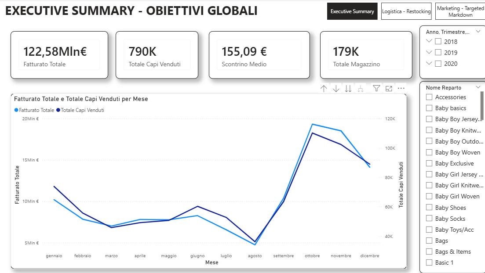
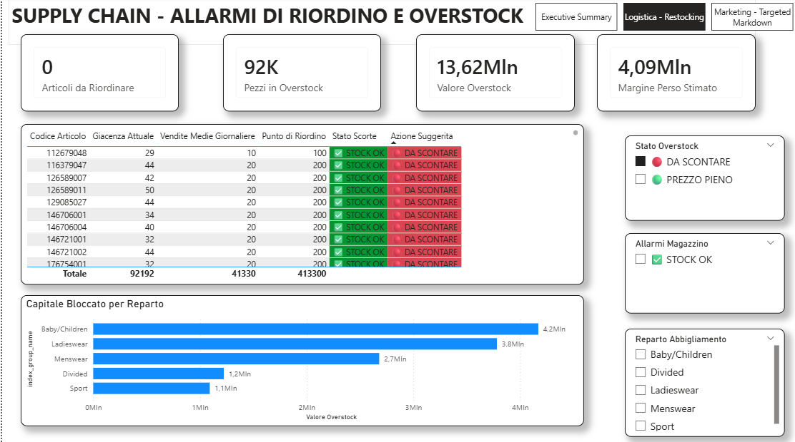
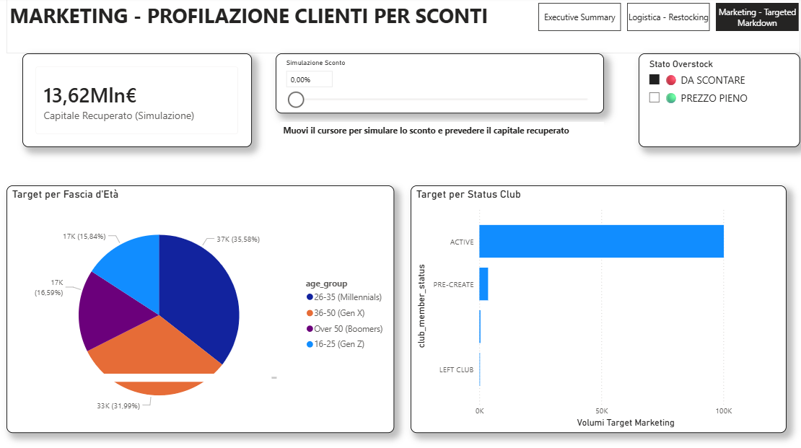

# 📊 Retail Analytics & Supply Chain Optimization: Progetto End-to-End

## 🎯 Panoramica del Progetto
Questo progetto rappresenta una soluzione completa di Data Analysis e Business Intelligence sviluppata per un'azienda del settore Retail (Fashion). L'obiettivo principale è ottimizzare la gestione dell'inventario, prevenire le rotture di stock (*stockout*) e fornire al reparto Marketing insight basati sui dati per smaltire le eccedenze di magazzino (*overstock*) attraverso campagne di sconto mirate (*markdown*).

## 🛠️ Tecnologie e Architettura dei Dati
* **1. SQL (Estrazione e Pulizia Dati):** Estrazione, pulizia e unione (*join*) delle tabelle storiche delle transazioni, dell'anagrafica clienti e del catalogo prodotti per creare un dataset solido e strutturato.
* **2. Python (Data Engineering e Motore Logico):** Calcolo delle vendite medie giornaliere, definizione delle soglie di sicurezza (*Reorder Point*) e sviluppo di algoritmi per classificare gli articoli come *"Ordine Urgente"* o *"Overstock"*.
* **3. Microsoft Power BI (Data Visualization e BI):** Modellazione relazionale e sviluppo di una dashboard direzionale interattiva.

---

## 📈 La Dashboard Power BI

### 1️⃣ Executive Summary (Top Management)
Una visione macroscopica dello stato di salute generale e delle performance dell'azienda.

### 2️⃣ Logistica - Riassortimento (Supply Chain)
Un hub operativo dedicato all'ufficio acquisti per evidenziare le criticità di magazzino e il capitale immobilizzato.

### 3️⃣ Markdown Mirato (Marketing & Vendite)
Un'area di supporto decisionale per smaltire l'overstock attraverso la profilazione clienti basata sui dati e un simulatore *What-If*.

